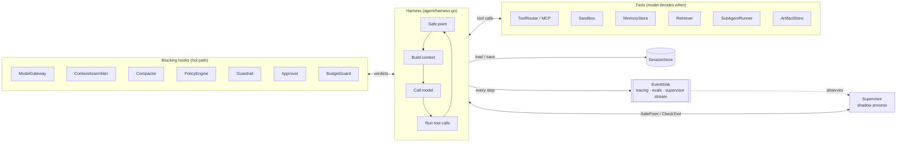

# agentharness

A minimal, modular agent harness in Go.

The harness owns one thing: **the loop**. It builds context, calls the model, runs tool calls, appends the results and repeats. Every other capability, including model routing, policy, memory, sandboxing, telemetry and supervision, is a service behind a Go interface. That service can live in-process, run as a sidecar, or be a remote microservice.

```bash
go run ./cmd/demo     # scripted run: policy blocks one call, the supervisor injects a note and blocks another
go test ./...
```

Requires Go 1.22+.

---

## Design goals

1. **Keep the harness small.** `agent/harness.go` is about 260 lines. Anything that can be expressed as a call through an interface lives outside it.
2. **Keep the harness stateless.** All state for a run lives in a `Session`, owned by a `SessionStore`. Resume, fork and replay are store operations, not harness features.
3. **Make everything optional except four services.** A model, a tool router, a context assembler and a session store are required. Every other service defaults to `Nop`, so you add capabilities one interface at a time.
4. **Make failure behaviour explicit.** Each service on the hot path has a defined outcome when it errors or times out (see [Failure semantics](#failure-semantics)).
5. **Keep supervision outside the loop.** A stateful "shadow" process can watch everything and intervene. The harness sees it only as two hook methods.

---

## Architecture



The harness reaches the outside world through **two kinds of interface**:

| | Called by | When | Examples |
|---|---|---|---|
| **Hooks** | the harness | at fixed points in every turn | policy, guardrails, budget, compaction, supervisor |
| **Tools** | the model | whenever it decides to | sandbox, memory, retrieval, sub-agents, artifacts |

Hooks come in two flavours. **Blocking** hooks return a `Verdict` and can veto or change what happens next. **Async** sinks only observe (`EventSink`).

The harness only knows tools through `ToolRouter` (`List` + `Call`). Typed interfaces like `Sandbox` and `MemoryStore` describe what concrete tool servers implement. You adapt them into tools, typically as MCP servers behind a router.

---

## The loop

`Harness.Run(ctx, sessionID, input)` processes one user input until the model ends its turn:

```
load session
input guardrails ──deny──▶ error
append user input
repeat up to MaxTurns:
    Supervisor.SafePoint      ← may inject content, pause, or stop
    Budget.Check              ← may stop
    Compactor.MaybeCompact
    Tools.List → Context.Build → Model.Complete
    Budget.Charge
    output guardrails ──deny──▶ error
    append assistant message
    no tool calls? ──▶ done
    for each tool call:
        Policy.CheckToolCall  ┐
        Supervisor.CheckTool  ┘ Combine → Deny | Ask | Rewrite | Allow
        Ask → Approver.Approve
        Tools.Call (with ToolTimeout)
    append tool results as one user message
    save session
save session (always, via defer)
```

Each step emits an `Event` with a per-session sequence number (`Session.Seq`). The step kinds are session start, turn start, model request and response, tool call and result, compaction, turn end and errors. Telemetry failures never stop the loop.

### Verdicts

Every blocking check returns a `Verdict{Action, Reason, By, Replacement}`. When several checks run, `Combine` keeps the strongest:

```
Deny  >  Ask  >  Rewrite  >  Allow
```

- **Deny**: the tool is not run. The model receives an error result naming who blocked it and why, so it can adapt.
- **Ask**: the call is escalated to the `Approver`, a human in the loop. The approver's verdict replaces the combined one. An approver that answers `Ask` again is treated as `Deny`.
- **Rewrite**: the call runs with `Replacement`'s name and arguments but keeps its original call ID. That keeps the transcript valid.
- **Allow**: the call runs.

### Provenance

Every `Block` carries a `Source`: `user`, `model`, `tool` or `supervisor`. The model, logs and evals can then tell a user's message from text the supervisor injected. Injected content is never mistaken for user input.

---

## Supervision

A **supervisor** is a stateful process that shadows the run and can intervene. A policy engine judges one call in isolation. A supervisor sees the whole run so far, so it can catch things like "the agent is looping" or "this is the third failed deploy."

### What the harness sees

Just one interface, two methods:

```go
type Supervisor interface {
    SafePoint(ctx, *Session) error                                      // before each model call
    CheckTool(ctx, *Session, ToolCall, ToolSpec, Event) (Verdict, error) // before each tool call
}
```

The harness knows nothing about directives, queues or pausing. The only error it treats specially is `agent.ErrStopped`, which ends the run. Any other error from `CheckTool` falls back to the [failure rules](#failure-semantics).

### What `package supervise` adds

`supervise.Supervisor` implements that interface on top of **two channels**:

| Channel | Direction | Mode | Used for |
|---|---|---|---|
| `Gate` | harness → supervisor | synchronous, with `GateTimeout` | "may this tool call run?" |
| `Inbox` | supervisor → harness | asynchronous | directives posted at any time |

Directives:

| Kind | Effect |
|---|---|
| `Inject` | add content at the next safe point, tagged `FromSupervisor` |
| `Block` | deny a specific call ID |
| `Rewrite` | replace a call's name and arguments |
| `Pause` / `Resume` | hold before the next model call |
| `Stop` | end the run with `ErrStopped` |
| `SetBudget` | change the session's budget cap |
| `SwitchModel` | change `Session.Model` for later turns |

It keeps the state for each session (blocked calls, rewrites, pending injections, paused flag) and records each applied directive as an event. Call `Forget(sessionID)` when a session is done.

### Safe points

Directives can arrive at any time, but the transcript is only changed at **safe points**. A safe point is before a model call, when the transcript ends with a user message. Most model APIs require every tool call to be followed by its result, and don't allow text in the middle of the model's turn. So injected content goes into the trailing user message (`Session.AppendUser`), next to the tool results.

Directives that don't change the transcript (`Block`, `Rewrite`, `Stop`) are also applied before each tool call. A supervisor can therefore still stop the second call of a multi-call turn.

### Stale directives

Each directive carries `AfterSeq`, the last event the sender had seen. If `MaxLag > 0`, directives more than `MaxLag` events behind the session are dropped, so a slow supervisor can't act on a state that no longer exists.

### Supervisors are interchangeable

A rules engine, a cheaper watcher model or a human dashboard all use the same interface. They subscribe to the event stream (`EventSink`) and post to the inbox. `ChanInbox` is an in-process inbox. For a remote supervisor, back `Inbox` with Redis Streams, NATS or a websocket.

---

## Failure semantics

| Situation | Outcome |
|---|---|
| Policy errors, or supervisor errors or exceeds `GateTimeout` | Tool `Risk >= Config.FailClosedAt` → **Deny**; otherwise **Allow** (default threshold: `RiskHigh`) |
| Supervisor returns `ErrStopped` | run ends with that error |
| Guardrail errors | treated as **Deny** |
| No approver configured and a verdict says `Ask` | **Deny** (`Nop` approver) |
| Approver errors | **Deny** |
| Unknown tool name | **Deny** by the harness |
| Tool returns an error or exceeds `ToolTimeout` | error result goes back to the model; run continues |
| Supervisor inbox errors | logged as an event; run continues |
| `EventSink` errors | ignored |
| `Budget.Check` / `Budget.Charge` errors | run ends |
| Model, `Tools.List`, `Context.Build` or `Compactor` errors | run ends with a wrapped error |
| `MaxTurns` reached | run ends with an error |

Whatever happens, the session is saved when `Run` returns.

---

## Service catalog

All interfaces are in `agent/services.go`.

| Group | Interface | Purpose | Default |
|---|---|---|---|
| **Required** | `ModelGateway` | providers, retries, fallback, caching | — |
| | `ToolRouter` | list and run tools (MCP servers + registry) | `LocalTools` (in-process) |
| | `ContextAssembler` | system prompt, skills, which tools to expose | `StaticContext` |
| | `SessionStore` | persist, resume, fork, replay | `MemStore` (in-memory) |
| **Hot path** | `Compactor` | shrink the transcript near the context limit | `Nop`: never compacts |
| | `PolicyEngine` | stateless allow/deny/ask/rewrite per call | `Nop`: allow |
| | `Guardrail` (list) | screen model input and output | none |
| | `Approver` | human approval | `Nop`: deny |
| | `BudgetGuard` | token, cost and time limits | `Nop`: unlimited |
| | `Supervisor` | stateful shadow process | `Nop`, or `supervise.Supervisor` |
| **Sinks** | `EventSink` / `MultiSink` | tracing, logs, evals, supervisor stream | `Nop`: discard |
| **Tool-side** | `Sandbox` | isolated code execution | — |
| | `MemoryStore` | scoped memories with lineage and `Promote` (user → team) | — |
| | `Retriever` | search and fetch | — |
| | `SubAgentRunner` | spawn another copy of this harness | — |
| | `ArtifactStore` | files produced by a run | — |
| **Infrastructure** | `IdentityProvider`, `CredentialBroker` | who the agent acts for; short-lived scoped tokens | — |
| | `Scheduler`, `ChannelAdapter` | cron, webhooks and event triggers; CLI, web, Slack and email front ends | — |
| | `SkillRegistry`, `Evaluator` | versioned skills; scoring of sessions | — |

The "Infrastructure" and "Tool-side" interfaces are contracts only. The harness never calls them directly.

---

## Configuration

```go
agent.Config{
    MaxTurns:     50,
    ToolTimeout:  2 * time.Minute,
    GateTimeout:  2 * time.Second,   // Supervisor.CheckTool only
    FailClosedAt: agent.RiskHigh,
}
```

`agent.DefaultConfig` holds these values. Mark risky tools with `ToolSpec.Risk`.

---

## Usage

```go
inbox := supervise.NewChanInbox()

h, err := agent.New(agent.Services{
    Model:      myGateway,                       // required
    Tools:      new(agent.LocalTools).Add(spec, handler),
    Context:    agent.StaticContext{System: "You are…", MaxTokens: 4096},
    Sessions:   agent.NewMemStore(),
    Policy:     myPolicy,                        // optional from here on
    Supervisor: supervise.New(inbox, myGate),
    Events:     agent.MultiSink{otelSink, evalSink, supervisorStream},
}, agent.DefaultConfig)

h.StartSession(ctx, &agent.Session{ID: "s1", UserID: "u1", Model: "claude-sonnet-5-5"})
sess, err := h.Run(ctx, "s1", []agent.Block{agent.Text(agent.FromUser, "hello")})

// from anywhere, at any time:
inbox.Post(supervise.Directive{SessionID: "s1", Kind: supervise.Inject,
    Content: []agent.Block{agent.Text("", "Stay within the staging environment.")}})
```

---

## Layout

```
agent/
  types.go       transcript, tools, model I/O, Session, Event, Verdict
  services.go    every service interface, grouped as in the catalog
  harness.go     the loop
  defaults.go    Nop, MemStore, StaticContext, LocalTools
supervise/
  supervise.go   agent.Supervisor built on Gate + Inbox; ChanInbox
  *_test.go      pause/resume, injection, rewrite, stop
cmd/demo/        fake model + policy + supervisor injection and block
```

---

## Deployment notes

- **Latency.** Blocking hooks run on every turn or every tool call. Run the policy engine, model gateway and supervisor gate on the same host as the harness (as sidecars), or in-process behind the same interface.
- **Start in-process.** The interfaces are what matter. Move a service out of process only when you need independent scaling, isolation or ownership.
- **Secrets.** The harness never holds credentials. Tools should get short-lived scoped tokens from a `CredentialBroker`.
- **Sub-agents are recursion.** A `SubAgentRunner` starts another instance of this same harness, so no orchestration logic lives in the loop.

## Non-goals and next steps

- **Streaming.** `ModelGateway.Complete` returns whole responses. Streaming would be added at the gateway and the `EventSink`, not in the loop.
- **Parallel tool calls.** Calls in one turn run in order, which keeps supervision deterministic.
- **An MCP client router.** `LocalTools` is a placeholder. The natural next step is a `ToolRouter` that fronts MCP servers.
